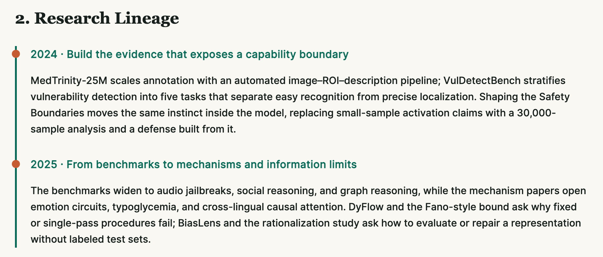
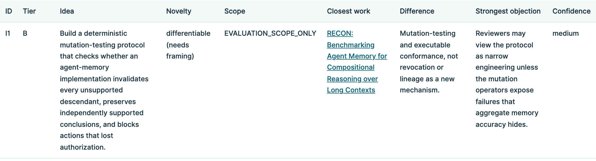
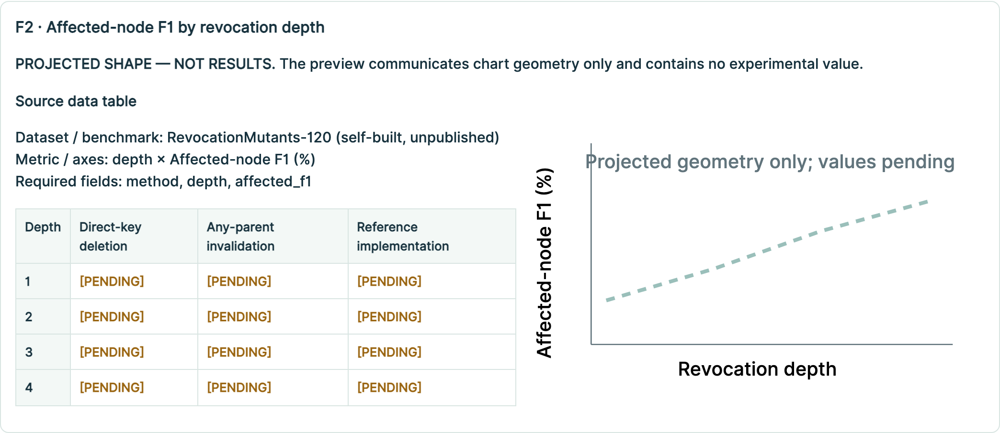
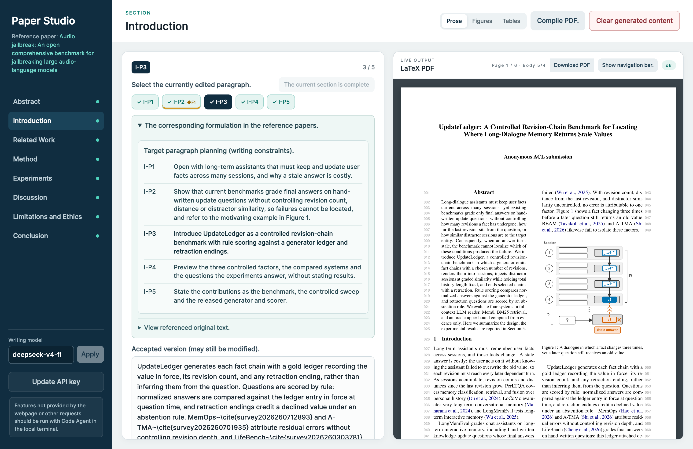

# Research Avatar: A Personalized Research Assistant

Research Avatar gives experienced researchers personalized assistance that speeds up mechanical work while keeping key decisions yours, not a fully autonomous AutoResearch system. Every step follows your research taste, writing style, and experiment habits, learned from your Scholar profile. Try it online: [register, upload, and start writing](https://research-avatar-studio.yingtaomj.workers.dev/)

---

## Highlights

| | Common open-source AutoResearch | Research Avatar |
|---|---|---|
| 💡 **Idea generation** | Generic brainstorming from a topic | Ideas tailored to your profile and the field map |
| 🧪 **Experiment organization** | Search and execution from a task objective | A projected paper plans the experiments first, then each goal runs through your coding agent's `/goal`; every number traceable |
| ✍️ **Paper output** | Automatic synthesis of intermediate results | Structure and writing adapted to your personal style |

---

## See it in action

**1. Researcher profile.** Built from your own publications, in four sections: 1. Research Identity, 2. Research Lineage, 3. Idea Profile, 4. Writing Profile. Every later stage builds on them.



**2. Idea selection.** A literature survey proposes several research questions and you pick one. From that question and your Idea Profile, several personalized ideas are generated; each is shown against the closest published work, with a concrete difference, the strongest objection, and a confidence level, and you make the final choice.



**3. Experiment plan.** A projected paper is planned first: its sections, figures and tables decide which experiments the paper needs and how many. The plan is then split into verifiable goals that your coding agent runs one by one with `/goal`. Every projected figure comes with the source table that experiments must fill; no value is shown until it is measured.



**4. Paper writing.** Each paragraph is drafted from your reference paper, which sets its structure and argument, and your Writing Profile, which sets the style. The matched writing plan sits beside each paragraph and a live LaTeX PDF on the right.



---

## Tutorial

**1. Prepare your inputs.** Save the complete HTML of a Google Scholar profile. You may use your own page, or that of a researcher whose research taste and paper organization you want to study. Paper writing needs one API key, DeepSeek by default; set it in a local terminal:

```bash
export DEEPSEEK_API_KEY="your API key"
# or, to write with OpenAI instead:
# export OPENAI_API_KEY="your API key"
```

**2. Build your profile.** In a coding agent, run:

```text
$profileconstruct using ~/Downloads/scholar_profile.html
```

**3. Run the workflow.** Invoke the stages in order from the same coding agent:

`$researchlit "research topic"` -> `$ideagen` -> `$expplan` -> `$runplan`

Each stage stops for your approval before the next one starts.

**4. Follow along and write.** Open <http://127.0.0.1:8780> to inspect every stage. When the experiments are done, continue in the paper-writing workspace on the same page.

---

<details>
<summary><h2>Implementation</h2></summary>

### Personalization

The authoritative personalization artifact is:

```text
researcher-profile/PROFILE.html
```

`$profileconstruct` reads the researcher's Google Scholar publication list and the verified full texts of their papers. For the 8 most recent first- or last-author papers, a model rewrites the idea, abstract and introduction from the same inputs, and the differences between the author's version and the model's version are recorded in `profile_pairs.json`.

The profile contains four sections:

- **Research Identity:** who the researcher is and the problems they work on;
- **Research Lineage:** how their research themes developed over the years;
- **Idea Profile:** how the author's ideas differ from what a model proposes for the same question;
- **Writing Profile:** separate Abstract and Introduction profiles from the paired comparisons, then profiles for the other section types found in their papers.

The researcher chooses the Scholar profile; it can be their own or that of a researcher they want to learn from.

### Experiments

1. **Plan the paper before deriving experiments.** Draft the expected abstract and paragraph architecture, then bind every claim to an experiment, metric, and fillable figure or table.
2. **Decompose the plan into verifiable goals.** Execute goals in dependency order, verify their completion criteria, and update result artifacts.
3. **Keep every number traceable.** Each result links to its raw record, execution command, calculation procedure, and verification status.

### Paper writing

1. **Two drafting modes.** Use the approved Experiment Planning architecture to generate a complete first draft or draft one paragraph at a time.
2. **Interactive paper workspace.** Generate and edit paragraphs, inspect reference structure and vector PDF previews, and write to LaTeX transactionally only after explicit acceptance.
3. **Personalized structure and style.** Each paragraph follows the matched paragraph of the researcher's reference paper for structure and argument and the Writing Profile for style, plus the target venue and document-level citation and logic checks.
4. **Publication-ready figure prompts.** Design a composition and convert it into editable PowerPoint and PDF artifacts.
5. **Real experimental figures and tables.** Read only traceable data under `results/`.

</details>

---

## Skills

| Skill | Purpose |
|---|---|
| `$profileconstruct` | Create or refresh the researcher profile from a Google Scholar export and the papers' verified full texts |
| `$researchlit "research topic"` | Retrieve and verify literature from several angles and create a structured survey |
| `$ideagen` | Generate personalized ideas from the chosen research question and your Idea Profile, then verify novelty against the closest work |
| `$expplan` | Plan the Projected Paper paragraph by paragraph and derive its experimental contracts |
| `$runplan` | Decompose the experiment into dependency-ordered executable goals |

Unless translation is explicitly requested, `$researchlit` does not call a translation API. The researcher must specify a target language before translation.

Paper writing is not started by a skill. The paper stage in Research Studio reads the approved architecture, structural reference, and experimental results, then calls the selected LLM API paragraph by paragraph in the browser before writing accepted content to LaTeX.

---

## Deliverables

Deliverables are organized into four groups:

```text
paper/
├── main.tex                 # 1. Paper: editable LaTeX source
└── main.pdf                 #    Compiled paper
results/                     # 2. Experiment results, raw records, metrics, and provenance
code/                        # 3. Reproducible code produced for each experiment goal
reports/
├── 01_LIT_SURVEY.html       # 4. Literature survey
├── 02_IDEA_REPORT.html      #    Idea selection report
├── 03_EXPERIMENT_PLAN.html  #    Experiment plan
├── 04_RUN_PLAN.html         #    Resumable run plan and goal status
└── 05_EXP_RESULT.html       #    Human-readable experiment results
```
